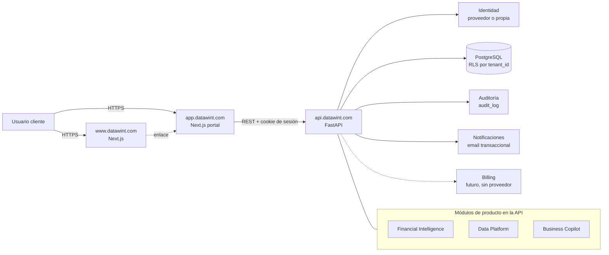

# Arquitectura DATAWINT

> Estado: propuesta · Fecha: 2026-11-03 · Alcance: web, portal de clientes y API.
> Decisiones tomadas: multi-tenant con BD compartida + `tenant_id` + RLS; roles validados en backend.

## 1. Dominios

| Dominio | Qué es | Stack | Estado |
|---|---|---|---|
| `www.datawint.com` | Web corporativa pública (marketing, productos, contacto). Sin datos de clientes. | Next.js (este repo) | Publicada |
| `app.datawint.com` | Portal de clientes: login, dashboard, "Mis aplicaciones", administración. | Next.js (repo nuevo) | No existe |
| `api.datawint.com` | API REST única. Toda la lógica, autorización y acceso a datos. | FastAPI + PostgreSQL | No existe |

Reglas de límites:
- La web **no** llama a la API ni maneja sesiones. Solo enlaza al portal (`NEXT_PUBLIC_PORTAL_URL`).
- El portal **no** accede a la base de datos: solo consume la API. La UI oculta opciones; la API decide.
- Cada producto SaaS (Financial Intelligence, Data Platform, Business Copilot) será un módulo de la API
  y una sección del portal, habilitado por organización mediante *entitlements*. No son apps separadas al inicio.

## 2. Diagrama

## 3. Servicios compartidos

| Servicio | Responsabilidad | Dónde vive |
|---|---|---|
| Identidad | Login, sesiones, recuperación de contraseña, MFA futura. | Proveedor externo o módulo propio (ver §5) |
| Autorización | Roles y permisos por organización; dependencias FastAPI. | API |
| Tenancy | Resolver la organización activa por request y fijarla en PostgreSQL. | API (middleware) |
| Auditoría | Registro inmutable de acciones relevantes (quién, qué, cuándo, desde dónde). | Tabla `audit_log` |
| Notificaciones | Emails transaccionales (invitación, recuperación). | API + proveedor SMTP/API |
| Entitlements | Qué productos y límites tiene contratados cada organización. | Tablas `subscriptions`, `entitlements` |
| Billing | Planes y facturación. Solo modelo de datos por ahora. | Futuro |

## 4. Multi-tenancy con Row Level Security

**Modelo:** una base PostgreSQL compartida. Toda tabla con datos de cliente lleva `organization_id`
(el `tenant_id`). RLS impide leer o escribir filas de otra organización aunque la consulta tenga un error.

**Flujo por request:**
1. La API valida la sesión y obtiene `user_id`.
2. Determina la organización activa (cabecera `X-Organization-Id` o la única membresía del usuario)
   y comprueba que el usuario tiene membresía activa en ella.
3. Abre una transacción y ejecuta `SET LOCAL app.current_org = '<uuid>'` (y `app.is_superadmin` si aplica).
4. Las políticas RLS filtran con `organization_id = current_setting('app.current_org')::uuid`.
5. Al terminar la transacción, el contexto desaparece (`SET LOCAL`), sin fugas entre requests del pool.

**Reglas obligatorias:**
- La API se conecta con un rol **sin** `BYPASSRLS` y que no es dueño de las tablas; se usa `FORCE ROW LEVEL SECURITY`.
- Las migraciones usan un rol distinto (owner), nunca la API.
- Superadmin DataWint: acceso entre tenants solo por endpoints `/admin/*`, con política RLS explícita y
  registro obligatorio en `audit_log`.
- Tests automáticos que verifican que un usuario de la organización A no ve datos de la B.
- Tablas globales (catálogo de `products`, `plans`, `permissions`) no llevan `organization_id`.

**Salida futura:** si un cliente enterprise exige aislamiento físico, se le puede mover a una base dedicada
con el mismo esquema; el `organization_id` facilita la extracción.

## 5. Autenticación (decisión pendiente)

| Opción | Coste aprox. | Esfuerzo inicial | Notas | Recomendación |
|---|---|---|---|---|
| Propia con FastAPI | Solo infraestructura | Alto (semanas): hashing argon2id, sesiones, recuperación, MFA, rate limiting | Control total; todo el riesgo de seguridad es propio | No por ahora |
| Auth0 | Gratis en tramo bajo; sube rápido con usuarios B2B y organizaciones | Bajo | Muy completo (organizaciones, MFA, SSO enterprise) | Alternativa si se necesita SSO pronto |
| Clerk | Gratis en tramo bajo; precio por usuario activo | Muy bajo | Excelente con Next.js; organizaciones incluidas | **Recomendada** para empezar |
| Keycloak | Gratis (open source) + coste de operarlo | Medio-alto | Self-hosted; hay que mantenerlo, parchearlo y respaldarlo | Solo si se exige self-hosting |
| Cognito | Barato por usuario | Medio | Bien si todo va en AWS; UX y personalización limitadas | Solo si se elige AWS |

Con cualquier proveedor, **roles, permisos y organizaciones de negocio viven en nuestra BD**; el proveedor
solo autentica. Precios orientativos: verificar en cada web antes de decidir.

## 6. Seguridad base

- Sesión del portal en cookie `HttpOnly`, `Secure`, `SameSite=Lax`, en `.datawint.com`; tokens cortos y refresh rotativo.
- CORS de la API restringido a `https://app.datawint.com`.
- Secretos solo en el gestor del hosting; nunca en `NEXT_PUBLIC_*` ni en el repositorio.
- Rate limiting en login, recuperación e invitaciones. TLS en todo; cifrado en reposo del proveedor de BD.
- Backups diarios automáticos con restauración probada; retención según contrato.
