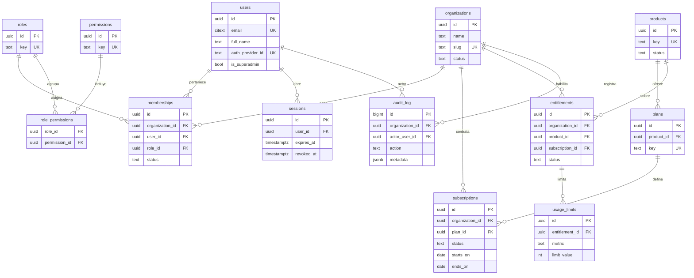

# Datos y permisos

> Estado: propuesta · Fecha: 2026-11-03 · Ver también [arquitectura.md](arquitectura.md).
> Convenciones: claves `uuid`, `created_at`/`updated_at` en todas las tablas, borrado lógico (`deleted_at`)
> en entidades de negocio. Las tablas marcadas **[tenant]** llevan `organization_id` y política RLS.

## 1. Diagrama ER (tablas clave)

## 2. Notas por tabla

| Tabla | Tipo | Clave |
|---|---|---|
| `organizations` | Global (raíz del tenant) | Cada cliente es una organización. `status`: activa, suspendida. |
| `users` | Global | Un usuario puede pertenecer a varias organizaciones. `is_superadmin` solo para personal DataWint. |
| `memberships` | **[tenant]** | Une usuario + organización + rol. Único por (`organization_id`, `user_id`). |
| `roles`, `permissions`, `role_permissions` | Global | Catálogo fijo; se carga por migración, no desde la UI. |
| `products` | Global | Catálogo: `financial-intelligence`, `data-platform`, `business-copilot`. `status` refleja el estado público. |
| `plans` | Global | Plan comercial de un producto (p. ej. básico, profesional). Sin precios hasta elegir billing. |
| `subscriptions` | **[tenant]** | Contrato de una organización a un plan, con vigencia. |
| `entitlements` | **[tenant]** | Producto **habilitado** para la organización. Es lo que consulta el portal en "Mis aplicaciones". |
| `usage_limits` | **[tenant]** | Límites por entitlement (usuarios, consultas, fuentes). Valores, no cobro. |
| `sessions` | Global | Solo si la autenticación es propia; con proveedor externo puede omitirse. |
| `audit_log` | **[tenant]** | Solo inserción (sin UPDATE/DELETE para el rol de la API). `organization_id` nulo = evento de plataforma. |

Política RLS tipo para tablas **[tenant]**:
`USING (organization_id = current_setting('app.current_org')::uuid OR current_setting('app.is_superadmin', true) = 'on')`.

## 3. Roles

| Rol (`roles.key`) | Quién | Alcance |
|---|---|---|
| `superadmin` | Personal DataWint (`users.is_superadmin = true`) | Toda la plataforma, solo vía `/admin/*` y siempre auditado. |
| `org_admin` | Administrador del cliente | Su organización: usuarios, roles y consulta de suscripciones. |
| `org_user` | Usuario del cliente | Uso de los productos habilitados para su organización. |

## 4. Matriz de permisos

✅ permitido · ❌ denegado · 👁 solo lectura

| Permiso (`permissions.key`) | Superadmin | Admin cliente | Usuario cliente |
|---|---|---|---|
| `org.read` (ver datos de su organización) | ✅ todas | ✅ la suya | 👁 la suya (básico) |
| `org.update` (nombre, datos de contacto) | ✅ | ✅ | ❌ |
| `org.create` / `org.suspend` | ✅ | ❌ | ❌ |
| `users.read` | ✅ | ✅ | ❌ |
| `users.invite` / `users.deactivate` | ✅ | ✅ | ❌ |
| `memberships.change_role` | ✅ | ✅ (no puede quitarse el último admin) | ❌ |
| `me.read` / `me.update` (perfil propio) | ✅ | ✅ | ✅ |
| `entitlements.read` ("Mis aplicaciones") | ✅ | ✅ | ✅ |
| `entitlements.manage` (habilitar productos) | ✅ | ❌ | ❌ |
| `subscriptions.read` | ✅ | 👁 | ❌ |
| `subscriptions.manage` / `plans.manage` | ✅ | ❌ | ❌ |
| `usage_limits.manage` | ✅ | ❌ | ❌ |
| `audit.read` | ✅ todas | 👁 la suya | ❌ |
| `product.<key>.use` (usar un producto) | ❌ por defecto | ✅ si hay entitlement | ✅ si hay entitlement |

## 5. Validación en el backend

- Cada endpoint declara su permiso con una dependencia FastAPI, p. ej. `Depends(require("users.invite"))`.
- La dependencia: valida sesión → resuelve organización activa → carga rol de la membresía →
  comprueba permiso → fija `SET LOCAL app.current_org` en la transacción.
- `product.<key>.use` exige además un `entitlement` activo para esa organización y producto.
- La UI del portal recibe los permisos en `GET /me` solo para **ocultar** opciones; nunca son la barrera.
- Toda denegación devuelve `403` sin revelar si el recurso existe en otra organización (o `404` uniforme).
